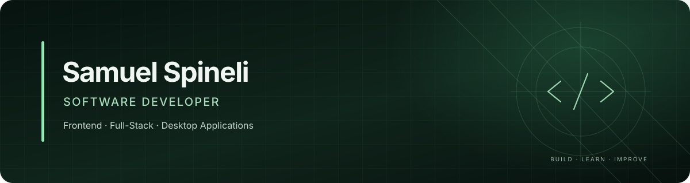

## About Me

Computer Science graduate with hands-on experience in software development, primarily focused on frontend engineering with **TypeScript and React**, alongside backend integrations using **Python**.

I enjoy building useful things, exploring different technologies, and collaborating with people across different areas of engineering.

Currently exploring **Rust, Tauri, desktop applications, and local AI**.

## Technologies

**Main stack**

  

**Also familiar with**

## Selected Projects

<table>
<tr>
<td width="50%" valign="top">

### [Esperto](https://github.com/samuelspineli34/Esperto)

**Desktop AI Application**

A desktop environment for working with AI models, bringing local inference, external providers, multimodal capabilities, and image generation workflows together.

`Rust` `Tauri` `React` `TypeScript`

</td>
<td width="50%" valign="top">

### [Osaka-Tech](https://github.com/samuelspineli34/Osaka-Tech)

**Internal Support Management**

A project focused on organizing technical support requests and internal workflows.

`TypeScript`

</td>
</tr>
<tr>
<td width="50%" valign="top">

### [Fretly](https://github.com/samuelspineli34/Fretly)

**Music Learning Application**

An interactive guitar fretboard learning tool designed to help musicians memorize notes through quizzes and audio feedback.

`TypeScript` `Web Audio`

</td>
<td width="50%" valign="top">

### [GenreID](https://github.com/samuelspineli34/GenreID)

**Music Classification**

An exploration of music classification and audio processing using Python.

`Python` `Audio Processing`

</td>
</tr>
</table>

<strong>More projects and experiments</strong>

- [Hemocentro](https://github.com/samuelspineli34/Hemocentro) — An application concept related to blood donation and blood center services.
- [Aplicativo-Risco-UV](https://github.com/samuelspineli34/Aplicativo-Risco-UV) — An application focused on UV exposure awareness.
- [Classificador-de-Osteoartrose](https://github.com/samuelspineli34/Classificador-de-Osteoartrose) — An academic classification project related to osteoarthritis.

## Activity

